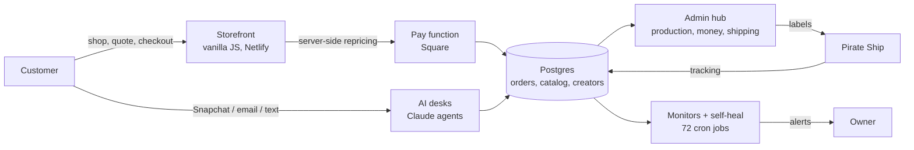

# NeSmith Decals: a one-person, AI-run commerce company

I built and run a custom vinyl decal business end to end: storefront, payments, production queue, shipping, a creator commission program, and a crew of AI agents that answer customers, chase orders, and watch the system around the clock. I am 20, self-taught, and I wrote or directed every layer of it in about five months.

This repository is the public case study. The production code is private because it handles real customers and payments; the samples here are cleaned excerpts of the real thing.

## By the numbers (live production data, November 2026)

| | |
|---|---|
| Revenue processed | **$32,900+** across **836 paid orders** and **715 customers** |
| Growth | **$165/month (Jan) to $7,389/month (Jul)**, about 45x in six months |
| Code | **~116,000 lines counted** across storefront, admin hub, database and tooling, plus ~150 serverless functions |
| Database | **94 tables, 135 views, 216 functions** across two Postgres projects |
| Automation | **72 scheduled jobs** and **39 AI agent tasks**, **123,000+ logged automation events** |
| Creator program | **65 creators** paid commission on tiered rates |
| Reputation | **5.0 stars** on Google |
| Build time | First file **May 31, 2026**, everything above live by **November 2026** |

## What I built

- **Storefront** (nesmithdecals.com): 180+ generated product pages, a live quote builder, cart with code stacking rules, and embedded Square checkout. Every price is re-computed server side so the browser can never change what a customer pays.
- **Admin hub**: a private mobile-first app that runs the shop day to day: make queue, order state machine, money dashboard with real fee and postage accounting, creator payouts, inventory.
- **AI operations desks**: scheduled Claude agents answer Snapchat and email in the owner's voice, close inquiries to paid invoices, follow up on leads, sync shipping labels, and write a twice-daily brief. They follow one written rulebook and log every action.
- **Reliability layer**: 32 guards that check the checkers. Heartbeats prove each agent is alive, a dead-man switch catches silent failures, and every all-clear must survive a planted negative control before it is trusted.
- **Creator economy**: invite-only codes, tiered commission (5/10/15%), a portal with OTP or password sign-in, a live leaderboard, and payout tracking.

## Engineering decisions I would defend in an interview

1. **The server is the only price authority.** The cart shows a price; the pay function recomputes it from the catalog and rejects anything that does not match. A shown-price vs charged-price guard runs daily.
2. **One state machine for orders.** Every status change goes through a single function with a dry-run mode that reports whether a customer would be emailed or texted before anything is written.
3. **A green check you never saw fail is not evidence.** Monitors are tested by planting a failure and confirming they catch it. This caught a watchdog that flagged normal weekend gaps as outages.
4. **Fix the source, not the surface.** When a renamed creator code orphaned an order's commission, the fix was a trigger that carries history through any rename, tested with a rollback before going live.
5. **Agents get rules, not vibes.** Every desk has hard rules (never send without a preflight identity check, never enter credentials, owner approves anything public) and a heartbeat, so a frozen agent shows up within minutes.

## Case studies

See [docs/CASE-STUDIES.md](docs/CASE-STUDIES.md) for five problems, what broke, and how I fixed them, and [docs/ARCHITECTURE.md](docs/ARCHITECTURE.md) for the full system map.

## Code samples

Cleaned excerpts in [`samples/`](samples/):

| File | What it shows |
|---|---|
| `discount-engine.js` | Client-side pricing that mirrors server rules exactly, including minimum-subtotal gates |
| `order-intent-parser.ts` | Rules-first intent extraction for customer DMs, with AI refinement re-validated like untrusted input |
| `pause-aware-monitors.sql` | Self-expiring maintenance windows for agent heartbeats, with a negative-control test |
| `rename-safe-commissions.sql` | Trigger that keeps commission history correct when a referral code is renamed |

## Stack

JavaScript (vanilla, no framework), TypeScript on Deno edge functions, PostgreSQL (Supabase) with RLS, PL/pgSQL, pg_cron, Python and PowerShell tooling, Netlify, Square payments, Resend email, Twilio SMS, Claude (Anthropic) agents, Pirate Ship shipping.

## About me

Christian NeSmith, founder of NeSmith Enterprises LLC, Rio Grande Valley, Texas. I am looking for an apprenticeship or engineering role in AI automation, full-stack or solutions engineering. Contact details are on my GitHub profile.
