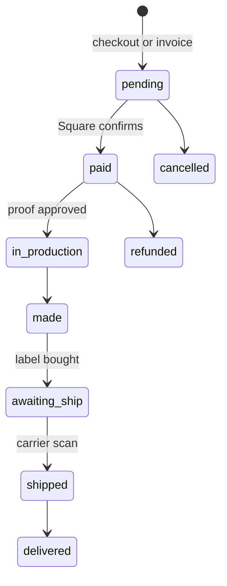

# Architecture

## Surfaces

| Surface | Purpose | Tech |
|---|---|---|
| Storefront | Catalog, quote builder, cart, checkout, order tracking, creator portal | Vanilla HTML/CSS/JS on Netlify, no build step |
| Admin hub | Owner app: production, money, shipping, creators, catalog editor | Single-page app, Supabase auth (sign-up disabled) |
| Edge functions | Payments, emails, SMS, creator auth, monitors, backups | TypeScript on Deno (Supabase), ~150 functions |
| Database | Orders, customers, catalog, creators, ledgers, heartbeats | PostgreSQL with RLS, 94 tables, 135 views, 216 functions |
| Agents | Customer desks, lead follow-up, shipping sync, daily brief | Claude agents on schedules, one shared rulebook |

## Order lifecycle

Every transition goes through one function. It supports a dry run that returns whether the change would email or text the customer, so automation can decide to mute a notification (for example, an old package marked delivered weeks late) before writing anything.

## Money correctness

- The browser computes a display price; the pay function recomputes from the server catalog and refuses mismatches.
- Sales tax, card fees, postage and creator commission are each a separate ledger so net profit is never guessed.
- A daily guard compares the price shown for every product against the price checkout would charge.

## Reliability

- **Heartbeats**: each agent writes a beat; a view decides OK / STALE / BLIND using each agent's real schedule.
- **Guards**: 32 checks that verify the other checks are fresh and agree with each other. If any guard is not OK, no all-clear is trusted.
- **Negative controls**: a monitor is only trusted after it has been shown to fail on a planted fault.
- **Backups**: nightly snapshots of both databases with a row-count parity check, plus a weekly offsite copy.

## Security

- Public sign-up disabled; one owner account. Owner-only functions check the caller's identity server side.
- Public lookups return the same answer for a missing code and an inactive one, so codes cannot be enumerated.
- Secrets live only in platform environment variables. A scrubber blocks any deploy that contains a key or a private phone number.
